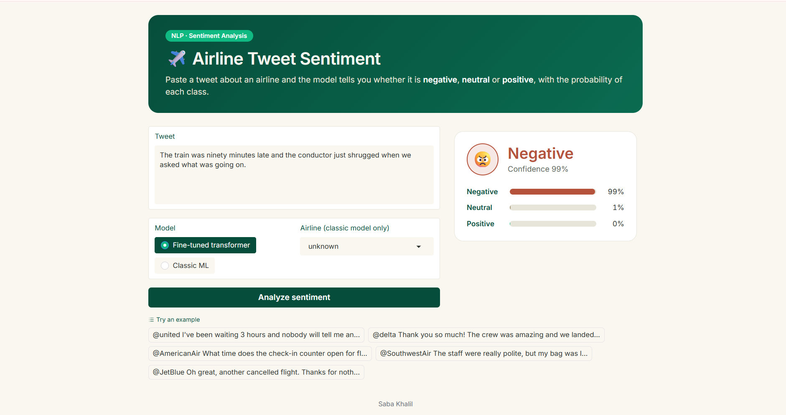
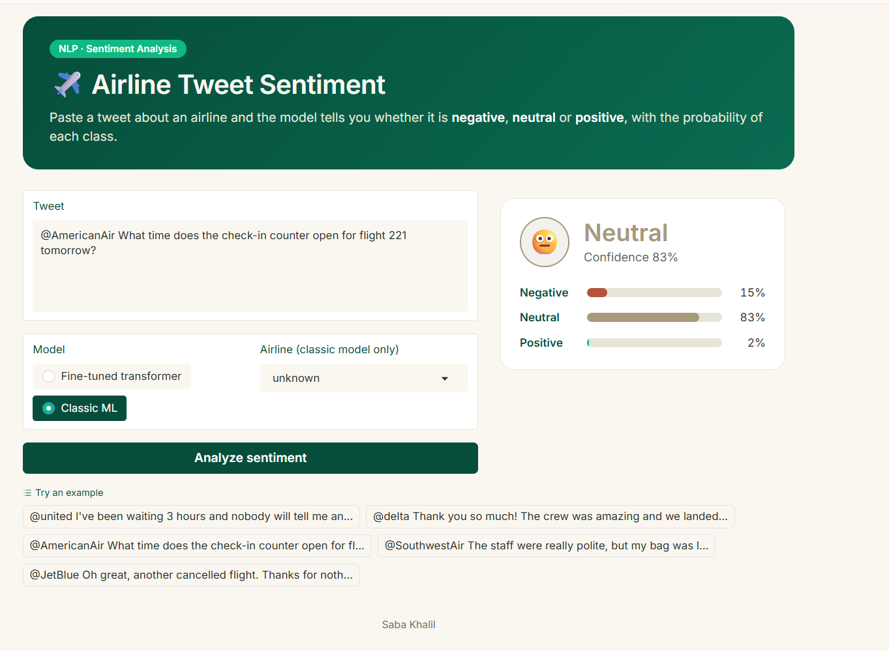
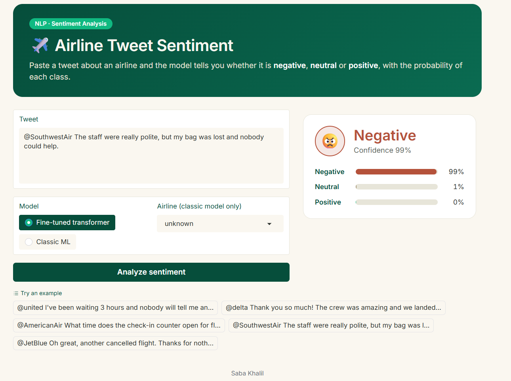

# ✈️ Airline Tweet Sentiment Classifier

A three-class NLP project that classifies airline-related tweets as **Negative, Neutral, or Positive**. This project compares a traditional machine-learning pipeline using TF-IDF and Logistic Regression with a fine-tuned RoBERTa transformer.

The goal is to evaluate how classical NLP techniques and transformer-based models handle sentiment classification, especially neutral, mixed, and ambiguous tweets.


## 📊 Results at a Glance

On the recorded held-out test set of 2,837 tweets, the fine-tuned RoBERTa model achieved a reported Macro F1 of **0.829**, compared with **0.754** for the classic machine-learning model.

| Model | Accuracy | Macro F1 |
|---|---:|---:|
| Majority-class baseline | 0.639 | 0.260 |
| TF-IDF + Logistic Regression | 0.805 | 0.754 |
| Classic ML with tuned class weights | 0.815 | 0.759 |
| **Fine-tuned RoBERTa** | **0.868** | **0.829** |

These values are from the notebook's recorded results and have not been independently reproduced in a fresh environment.

## 📌 Project Overview

Sentiment analysis is a natural language processing task that identifies the emotional polarity expressed in text.

This project uses the [Twitter US Airline Sentiment dataset on Kaggle](https://www.kaggle.com/datasets/crowdflower/twitter-airline-sentiment). It contains tweets about US airlines labeled as negative, neutral, or positive.

The project explores two approaches:

- **Traditional machine learning:** TF-IDF features with Logistic Regression and other classical classifiers.
- **Transformer-based learning:** Fine-tuning `cardiffnlp/twitter-roberta-base-sentiment-latest` for the three-class task.

The notebook also explores preprocessing choices, class imbalance, label quality, model errors, and interactive predictions.

## ✨ Key Features

- Text cleaning and near-duplicate analysis
- Word-level and character-level TF-IDF features
- Comparison of multiple classical classifiers
- Cross-validation for model comparison
- Class-weight and neutral-class threshold experiments
- Fine-tuning of a pretrained RoBERTa model
- Accuracy, Macro F1, per-class F1, and confusion-matrix evaluation
- Bootstrap confidence intervals and model comparison
- Analysis of noisy labels and common classification errors
- Interactive Gradio demo

## 🖥️ Demo

The notebook includes a Gradio interface where users can enter a tweet, select a model, and inspect its predicted sentiment and class scores.

### Example 1: Negative sentiment

Tweet:

> The train was ninety minutes late and the conductor just shrugged when we asked what was going on.



The recorded demo predicts **Negative** with a displayed confidence of 99%.

### Example 2: Neutral sentiment

Tweet:

> @AmericanAir What time does the check-in counter open for flight 221 tomorrow?



The recorded demo predicts **Neutral** with a displayed confidence of 83%.

### Example 3: Mixed sentiment

Tweet:

> @SouthwestAir The staff were really polite, but my bag was lost and nobody could help.



The recorded demo predicts **Negative** with a displayed confidence of 99%.

These are illustrative examples, not a substitute for evaluation on held-out data. Displayed confidence scores should not be interpreted as calibrated probabilities unless calibration has been evaluated.

## 📈 Model Evaluation

The notebook reports the following per-class F1 scores:

| Model | Negative F1 | Neutral F1 | Positive F1 |
|---|---:|---:|---:|
| Classic ML | 0.878 | 0.653 | 0.730 |
| Fine-tuned RoBERTa | 0.923 | 0.729 | 0.834 |

The reported results suggest that RoBERTa improves performance across all three classes, with a particularly useful improvement on neutral sentiment.

### Evaluation methods

The notebook includes:

- Stratified train/test splitting
- Cross-validation for classical model and preprocessing comparisons
- Macro F1 to account for class imbalance
- Per-class metrics and confusion matrices
- Bootstrap confidence intervals
- Error analysis for misclassified tweets

The notebook documents one held-out split and one fine-tuning run. Repeated transformer runs with different random seeds would provide stronger evidence of the stability of the reported results.

## 🔍 Key Findings

1. **Preprocessing choices matter.** Removing stop words did not improve the recorded results; retaining sentiment-related signals can be useful for tweets.
2. **Character n-grams help.** The recorded experiments show an improvement when character-level features are combined with word-level TF-IDF features.
3. **Classical models provide a strong baseline.** Logistic Regression performs well while remaining relatively lightweight compared with transformer fine-tuning.
4. **Neutral sentiment is challenging.** Neutral and mixed tweets can be difficult to distinguish, particularly when labels are uncertain.
5. **Label quality matters.** The notebook's label-confidence analysis suggests that noisy or ambiguous labels contribute to classification errors.
6. **Transformers perform better in the recorded evaluation.** RoBERTa achieves the highest reported Macro F1 among the compared models.

## 🔄 Project Workflow

1. Load the airline sentiment dataset.
2. Inspect the labels and remove duplicates using the documented text-normalization procedure.
3. Split the data into training and held-out test sets.
4. Compare preprocessing variants using cross-validation.
5. Build word and character TF-IDF features.
6. Compare classical machine-learning classifiers.
7. Experiment with class weights and neutral-class thresholds.
8. Fine-tune the pretrained RoBERTa model.
9. Evaluate predictions and inspect classification errors.
10. Run the interactive Gradio demo.

**Evaluation note:** For a final unbiased model-selection result, select the winning model using training and validation data, then evaluate that selected model on the held-out test set. Comparisons of multiple models on the test set should be described carefully.

## 🛠️ Technologies Used

| Technology | Purpose |
|---|---|
| Python | Main programming language |
| pandas and NumPy | Data manipulation |
| scikit-learn | TF-IDF, classical models, cross-validation, metrics |
| NLTK | Stop words and lemmatization |
| Hugging Face Transformers | RoBERTa fine-tuning |
| PyTorch | Transformer training and inference |
| SciPy | Statistical utilities |
| Matplotlib and Seaborn | Visualizations |
| Gradio | Interactive interface |
| Kaggle | Dataset access and notebook execution |

## 📁 Project Structure

```text
airline-tweet-sentiment/
├── README.md
├── requirements.txt
├── .gitignore
├── LICENSE
├── Notebook/
│   └── sentiment-analyser.ipynb
└── docs/
    ├── demo-1-transformer-negative.png
    ├── demo-2-classic-neutral.png
    └── demo-3-transformer-mixed.png
```

The dataset and trained model artifacts are not required to be stored in the repository. Update the structure above if your actual filenames differ.

## ⚙️ Installation and Setup

### 1. Clone the repository

```bash
git clone https://github.com/sabakhalil806-collab/airline-tweet-sentiment.git
cd airline-tweet-sentiment
```

### 2. Create a Python environment

```bash
python -m venv .venv
```

Activate the environment:

**Windows:**

```bash
.venv\Scripts\activate
```

**macOS or Linux:**

```bash
source .venv/bin/activate
```

### 3. Install dependencies

```bash
python -m pip install --upgrade pip
pip install -r requirements.txt
```

For GPU-based transformer training, install a PyTorch build compatible with your CUDA environment. Refer to the [official PyTorch installation guide](https://pytorch.org/get-started/locally/).

## 📚 Dataset Setup

This project uses the [Twitter US Airline Sentiment dataset](https://www.kaggle.com/datasets/crowdflower/twitter-airline-sentiment).

The dataset is not included in this repository.

1. Download the dataset from Kaggle and locate `Tweets.csv`.
2. If using Kaggle, add the dataset to your notebook through Kaggle's input feature.
3. If running locally, place `Tweets.csv` in a location searched by the notebook's dataset-loading code.
4. Check the dataset path before running the notebook.

The notebook searches for `Tweets.csv` in the current working directory and under `/kaggle/input`. If you store the file elsewhere, update the loader to use that path.

Follow the dataset provider's terms when downloading or redistributing data.

## ▶️ Running the Notebook

### Option A: Kaggle

1. Upload `Notebook/sentiment-analyser.ipynb` to Kaggle.
2. Attach the airline sentiment dataset.
3. Enable a GPU accelerator if you want to run transformer fine-tuning.
4. Run the notebook cells in order.
5. Follow the notebook's output for the Gradio demo.

Transformer training may be skipped when CUDA is unavailable, depending on the notebook's configuration. Classical machine-learning experiments can run on a CPU, although repeated cross-validation may take some time.

### Option B: Local Jupyter Notebook

After installing dependencies and setting up `Tweets.csv`, run:

```bash
pip install jupyter
jupyter notebook
```

Open `Notebook/sentiment-analyser.ipynb` and execute the cells in order.

The first complete run may take significant time, particularly during cross-validation and transformer fine-tuning.

## ⚠️ Limitations

- The dataset consists of US airline tweets from 2015 and may not represent modern social-media language or other domains.
- Sentiment labels can be ambiguous, especially for neutral and mixed statements.
- Heuristic error tags are useful for exploration but are not equivalent to manually verified annotations.
- The recorded transformer result comes from one fine-tuning run and one random seed.
- Model scores do not guarantee reliable predictions on unseen domains.
- Displayed confidence scores are not necessarily calibrated probabilities.

## 🚀 Future Improvements

- Evaluate multiple random seeds for more stable transformer results.
- Improve separation between model selection and final test evaluation.
- Evaluate probability calibration.
- Test on an external dataset to measure cross-domain generalization.
- Improve handling of negation, sarcasm, and mixed sentiment.
- Package inference code separately from the training notebook.
- Deploy a persistent demo, for example using [Hugging Face Spaces](https://huggingface.co/spaces).
- Explore aspect-based sentiment analysis and airline-specific complaint categories.

## 📄 License

This project declares the MIT License. See [`LICENSE`](LICENSE) for details.

## 👤 Author

**Saba Khalil**  
